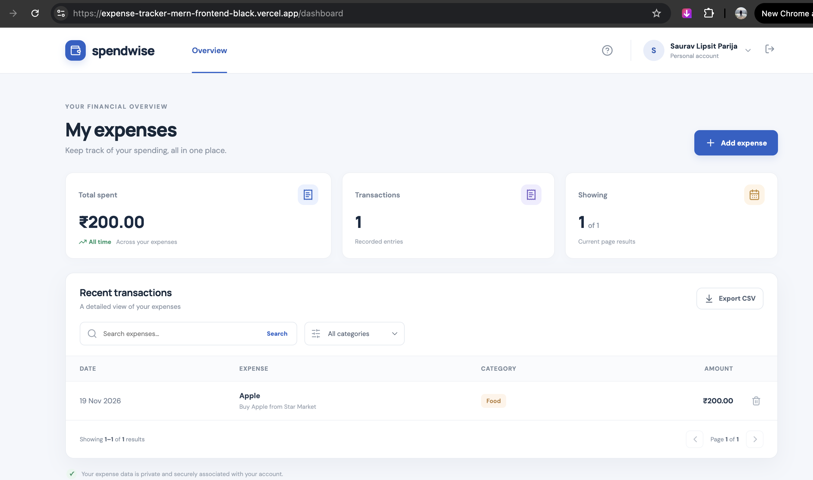
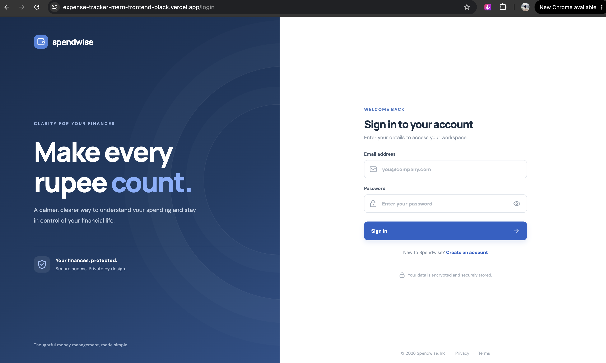
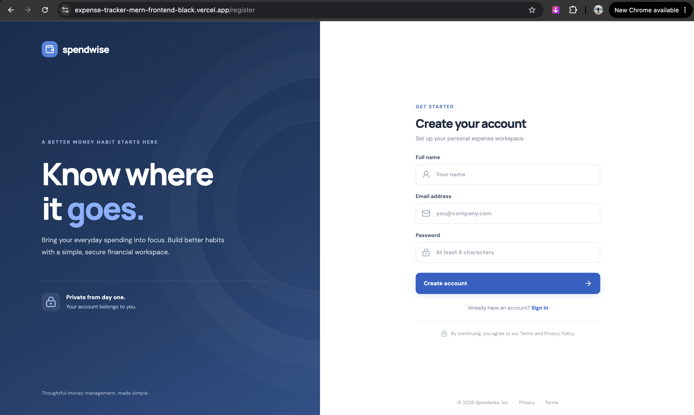

# Spendwise – Expense Management Application

A full-stack MERN expense management application built using React, TypeScript, Node.js, Express.js, MongoDB Atlas and JWT authentication.

## 🚀 Live Demo

*Live Application:* [Open Spendwise](https://expense-tracker-mern-frontend-black.vercel.app/)

*Backend API:* https://spendwise-api-m9ab.onrender.com

## 📸 Application Screenshots

### Dashboard

### Login

### Registration

## ✨ Features

•⁠  ⁠Secure JWT authentication
•⁠  ⁠User registration and login
•⁠  ⁠Add and manage expenses
•⁠  ⁠Category-based filtering
•⁠  ⁠Server-side pagination
•⁠  ⁠Total expense calculation
•⁠  ⁠Responsive enterprise-style UI
•⁠  ⁠MongoDB Atlas integration

## 🛠 Technology Stack

•⁠  ⁠Frontend: React, TypeScript, Vite
•⁠  ⁠Backend: Node.js, Express.js, TypeScript
•⁠  ⁠Database: MongoDB Atlas, Mongoose
•⁠  ⁠Authentication: JWT, bcrypt
•⁠  ⁠API: REST, Axios
•⁠  ⁠Deployment: Vercel, Render

## 🏗 Architecture

React + TypeScript → Express REST API → MongoDB Atlas

## 💻 Run Locally

### Backend

⁠ bash
cd backend
npm install
npm run dev
 ⁠

### Frontend

⁠ bash
cd frontend
npm install
npm run dev
 ⁠

Configure the required environment variables using the ⁠ .env.example ⁠ files.

## 👨‍💻 Author

Developed as a full-stack MERN portfolio project.